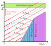

# Equations of state (Part I)

Goals:
- Global energetics
- Basic ideal equation of state (EOS)
- Radiation pressure
- Barebones stellar evolution
- Deriving an EOS from a momentum distribution

## Global energetics

Let's make use of the energy equation written in terms of time derivatives of the specific internal energy ($u$) and volume ($v$):

$$\frac{\partial u}{\partial t}+P\frac{\partial v}{\partial t}=\varepsilon_\mathrm{nuc}-\frac{\partial L}{\partial m}.$$

To describe global properties of the star we can integrate this equation over the total mass of the star,

$$\int_0^M\left[\frac{\partial u}{\partial t}+P\frac{\partial v}{\partial t}\right]\mathrm{d}m=\int_0^M\left[\varepsilon_\mathrm{nuc}-\frac{\partial L}{\partial m}\right]\mathrm{d}m.\tag{2.2}$$

Integrating $\varepsilon_\mathrm{nuc}$ gives us the total nuclear energy generation rate in the star, to which we refer as $L_\mathrm{nuc}$. We also have that

$$\int_0^M\frac{\partial u}{\partial t}\mathrm{d}m=\frac{\partial}{\partial t}\int_0^M u\mathrm{d}m = \dot{E}_i,$$

where we recall that $E_i$ is the total internal energy of the gas. Using this Equation (2.2) becomes

$$\dot{E}_i+\int_0^M P\frac{\partial v}{\partial t}\mathrm{d}m=L_\mathrm{nuc}-L_\mathrm{surf}+L(0),$$

where $L_\mathrm{surf}=L(m=M)$ is the luminosity at the stellar surface. Using the central boundary condition on the luminosity we get that

$$\dot{E}_i-\int_0^M P\frac{\partial v}{\partial t}\mathrm{d}m = L_\mathrm{nuc}-L_\mathrm{surf}.$$

The right hand side of this equation is equal to the energy injected onto the star minus the energy radiated away from its surface. We then expect the left hand side of the equation to correspond to the rate of change of the total energy $E=E_i+E_g$. For this to be true, then we require that

$$\dot{E}_g = \int_0^MP\frac{\partial v}{\partial t}\mathrm{d}m. \tag{2.4}$$

We take Equation $(2.4)$ as a consequence of the energy equation, but instead, let's verify that it is correct in terms of the definition of $E_g$ and the equation of hydrostatic equilibrium. First, it is straightforward to relate $\dot{v}$ to $\dot{\rho}$:

$$\frac{\partial v}{\partial t}=\frac{\partial}{\partial t}\left(\frac{1}{\rho}\right)=-\frac{\dot{\rho}}{\rho^2}$$
$$\rightarrow \int_0^M P\frac{\partial v}{\partial t}\mathrm{d}m = -\int_0^M \frac{P\dot{\rho}}{\rho^2}\mathrm{d}m.\tag{2.5}$$

We can also obtain $\dot{E}_g$ from the virial theorem:

$$E_g=-3\int_0^M\frac{P}{\rho}\mathrm{d}m$$
$$\rightarrow\dot{E}_g=-3\int_0^M\frac{\dot{P}}{\rho}\mathrm{d}m + 3\int_0^M\frac{P\dot{\rho}}{\rho^2}\mathrm{d}m \tag{2.6}$$

The first integral on the right hand side can be obtained from the equation of hydrostatic equilibrium,

$$\left.\frac{\partial P}{\partial m}=-\frac{Gm}{4\pi r^4}\quad\right/\frac{\partial}{\partial t}\cdot$$
$$\left.\frac{\partial \dot{P}}{\partial m}=4\frac{Gm}{4\pi r^4}\frac{\dot{r}}{r}\quad\right/4\pi r^3\cdot$$
$$\left.4\pi r^3 \frac{\partial \dot{P}}{\partial m}=4\frac{Gm}{r}\frac{\dot{r}}{r}\quad\right/\int_0^M(\;)\mathrm{d}m$$
$$\int_0^M 4\pi r^3 \frac{\partial \dot{P}}{\partial m}\mathrm{d}m=4\int_0^M\frac{Gm}{r}\frac{\dot{r}}{r}\mathrm{d}m.\tag{2.7}$$

From the definition of $E_g$ we have

$$E_g=-\int_0^M\frac{Gm}{r}\mathrm{d}m$$
$$\rightarrow \dot{E}_g=\int_0^M \frac{Gm}{r}\frac{\dot{r}}{r}\mathrm{d}m.$$

Replacing this in Equation $(2.7)$ and integrating the left hand side by parts gives

$$\left.\left(4\pi r^3 \dot{P}\right)\right|_0^M-3\int_0^M 4\pi r^2 \frac{\partial r}{\partial m}\dot{P}\mathrm{d}m=4\dot{E}_g,$$

where the first term is zero due to the boundary conditions, and using the equation of continuity to replace $\partial r/\partial m$ results in

$$-3\int_0^M\frac{\dot{P}}{\rho}\mathrm{d}m=4\dot{E}_g.$$

Replacing this in Equation $(2.6)$ one obtains

$$\dot{E}_g=-\int_0^M \frac{P\dot{\rho}}{r^2}\mathrm{d}m,$$

which combined with Equation $(2.5)$ shows that indeed Equation $(2.4)$ is correct. This means that Equation $(2.3)$ is equivalent to

$$L_\mathrm{nuc}-L_\mathrm{surf}=\dot{E}_i+\dot{E}_g = \dot{E},$$

which is what we expect in terms of the evolution of the total energy and its sinks and sources.

## Basic ideal EOS

Let us consider an ideal gas composed of multiple atoms/ions distinguished by an index $i$. Each component provides a pressure that follows an ideal gas law for its corresponding particle density:

$$P_i = n_i k_\mathrm{B}T=\frac{X_i \rho}{\mu_i m_u}T,$$

where $n_i$ is the number density of atoms/ions of type $i$, $m_\text{u}$ is the atomic mass unit, and $\mu_i$ is the atomic mass of the corresponding element in units of the atomic mass unit. The value $X_i$ represents the mass fraction, meaning that $X_i\rho$ corresponds to the density of atoms/ions of that type. In a hot plasma we will have a large number of free electrons that will also contribute to the pressure,

$$P_e=n_e k_\text{B}T,$$

where $n_e$ is the number density of free electrons.

For simplicity, let us consider a fully ionized gas. If each ion has an atomic number $Z_i$, then

$$n_e = \sum_i \frac{X_i \rho}{\mu_i m_\text{u}}Z_i,$$

such that the total gas pressure is

$$P_\text{gas}=P_e + \sum_i P_i = \sum_i \frac{X_i\rho}{\mu_i m_\text{u}}(1+Z_i).$$

This can be used to define the mean molecular weight $\mu$:

$$\frac{1}{\mu} \equiv \sum_i \frac{X_i}{\mu_i}(1+Z_i)\rightarrow P=\frac{\rho}{\mu m_\text{u}}k_\text{B}T.$$

We can estimate the value of the atomic mass in terms of the atomic mass number $A_i$, since $\mu_i \simeq A_i$. As a reminder, the atomic mass unit is by definition $1/12$ of the mass of an unbound $^{12}\text{C}$ atom, such that for $^{12}\text{C}$ the atomic mass is $12$. For hydrogen the atomic mass is around $1.0078$ and it is precisely this mass difference which allows the release of energy through nuclear fusion. Nevertheless, by approximating $\mu_i \simeq A_i$ we find that

$$\frac{1}{\mu}=\sum_i X_i \left(\frac{1}{A_i} + \frac{Z_i}{A_i}\right).$$

We now make use of a very common definition in astrophysics. We take $X$ to represent the mass fraction of hydrogen and all its isotopes (for the most part, this will be $^1\text{H}$) and $Y$ to represent the same for all helium isotopes (mostly $^4\text{He}$). All other elements are grouped together on what we call metals, with the letter $Z$, and mass conservation requires that $X+Y+Z=1$. Based on this we can approximate $\mu$ as

$$\frac{1}{\mu}=2X + \frac{3}{4}Y + \sum_{\text{metals}}X_i\left(\frac{1}{A_i} + \frac{Z_i}{A_i}\right).$$

As we will see later on, stellar evolution tends to produce metals with equal numbers of protons and neutrons (such as $^{12}\text{C}$, $^{14}\text{N}$ and $^{16}\text{O}$), and there is not much mass contained in the elements with atomic numbers between helium and carbon. From this we have that

$$\sum_{\text{metals}}X_i\left(\frac{1}{A_i} + \frac{Z_i}{A_i}\right) \simeq \sum_{\text{metals}}X_i\left(0 + \frac{1}{2}\right),$$

from which the approximation to the mean molecular weight is finally given by

$$\frac{1}{\mu} = 2X +\frac{3}{4}Y + \frac{1}{2}Z.$$

We can use this estimate for the mean molecular way in two extreme cases. For the case of pure hydrogen, we find $\mu\simeq1/2$, meaning that per atomic mass unit we have two free particles. Similarly for helium we have that $\mu\simeq 4/3$, such that every 4 atomic mass units we have three free particles. Since an ionized helium gas has a higher mean molecular weight than a hydrogen one, at a fixed temperature it will have a lower pressure. A clear consequence of this is that as the core of a star burns hydrogen into helium, it will necessarily contract to higher density to retain hydrostatic equilibrium.

## Radiation pressure

A gas in thermodynamic equilibrium is not just composed of ions and electrons, but also radiation that follows a Planck distribution. As we will see later, this provides an additional form of pressure:

$$P_\text{rad}=\frac{a}{3}T^4,$$

such that our full pressure for an ideal gas with radiation is given by

$$P=\frac{\rho}{\mu m_\text{u}}k_\text{B}T + \frac{a}{3}T^4.$$

The specific internal energy can also be expressed as a sum of the gas and radiation components:

$$u = \frac{1}{\rho}\left(\frac{3}{2}n k_\text{B}T + aT^4\right)=\frac{3k_B T}{2\mu m_\text{u}} + \frac{aT^4}{\rho},$$

which combined with the pressure allows us to extract all the properties we need to compute our stellar evolution model, such as the derivatives $\alpha$ and $\delta$ as well as the heat capacities.

A useful quantity to characterize a plasma composed of ions and radiation pressure is the ratio

$$\beta = \frac{P_\text{gas}}{P},$$

which essentially encodes the important of the gas pressure (done by atoms/ions and free electrons) as compared to that of radiation. In particular we can assess the point at which radiation becomes very important by considering the point where

$$\beta = \frac{1}{2}\rightarrow \frac{\rho k_\text{B}T/\mu m_\text{u}}{aT^4/3}\rightarrow T^3\propto \frac{\rho}{\mu}.$$

Whenever we find these power law relationships, it can be convenient to express them in terms of logarithms, since then we can describe the boundary for which $\beta=1/2$ as a line

$$\log T = A + \frac{1}{3}\log\rho -\frac{1}{3}\log \mu.\tag{2.8}$$

## Barebones stellar evolution
With what we have done so far we can see some aspects of stellar evolution. Let us consider the equation of hydrostatic equilibrium in its Lagrangian form,

$$\frac{\partial P}{\partial m}=-\frac{Gm}{4\pi r^4}.$$

We will now make a very violent approximation, which we will formalize towards the end of this class. We approximate the derivative as

$$\frac{P_\text{s} - P_\text{c}}{M} \simeq - \frac{GM}{4\pi R^4}.$$

where $P_\text{s}$ and $P_\text{c}$ are the surface and central pressure while $M$ and $R$ are the total mass and radius of the star. Making use of the boundary condition $P_\text{s}=0$, we find:

$$P_c\propto \frac{M^2}{R^4}.\tag{2.9}$$

If you are unconvinced by this, you can show that this will indeed be the case for any set of solutions with a polytropic equation of state with fixed polytropic index, in which case the proportionality constant in the expression is fixed. Furthermore we can approximate the central density as

$$\rho_\text{c} \propto \frac{M}{R^3}\rightarrow R\propto \frac{M^{1/3}}{\rho_\text{c}^{1/3}},$$

which after replacement in Equation $(2.9)$ gives

$$P_\text{c}\propto M^{2/3}\rho^{4/3}.$$

Finally, if we consider that the gas can be approximated to be ideal with a negligible contribution of radiation pressure, we find that:

$$P_\text{c}=\frac{\rho}{\mu m_\text{u}}k_\text{B}T_\text{c}\propto M^{2/3}\rho_\text{c}^{4/3},$$

which we can use to describe the evolutionary track of a star in the central temperature-density diagram.

$$\log T_\text{c} = B + \frac{1}{3}\log \rho_\text{c} + \frac{2}{3}\log M +\log\mu.\tag{2.10}$$

Based on this let us discuss how a star would evolve in terms of its central pressure and density. This is illustrated below, including additional elements that we will derive throughout our class.

In particular, Equation $(2.10)$ implies that as a star contracts, it will follow a trajectory parallel to the locus determined by Equation $(2.8)$ for the boundary where radiation pressure becomes very important. Tracks with higher mass will evolve higher up in this diagram, leading to radiation pressure playing a larger role in more massive stars. As a star contracts, conditions will be satisfied in its core that allow for the burning of succesively heavier nuclei. However, as we will see next class, quantum effects set a boundary where the approximation of an ideal gas breaks down (in which case we have a degenerate gas) and this sets critical differences in the final states of stellar evolution as a function of mass. Special relativity also plays an important role here, so we consider the regimes of non-relativistic (NR) and extremely-relativistic (ER) degeneracy here.

## Derive an EOS from a distribution of momenta

So, once we manage to write down our EOS as $\rho=\rho(P,T)$, and we also determine its internal energy $u=u(P,T)$, we can determine $c_P$, $\alpha$ and $\delta$. This gives us what we need for the energy equation.

But how can we derive $\rho(P,T)$ and $u(P,T)$? Next class we'll work on that, considering that a gas has multiple particles with a distribution of their velocities (and momenta). We can express the number of particles in a volume $\mathrm{d}V$ that have a momentum between $p$ and $p+\mathrm{d}p$ as

$$N(p,p+\mathrm{d}p)=n_p\mathrm{d}p\mathrm{d}V=nf(p)\mathrm{d}p\mathrm{d}V,$$

where $n$ is the number of particles per unit volume and $f(p)$ is a probability density for a particle to have a given momentum.If we can find $f(p)$ then we can determine macroscopic properties such as pressure and internal energy density. For example, next week we'll show that

$$P=\frac{1}{3}\int_0^\infty v_p p n_p\mathrm{d}p,$$

where $v_p$ is the velocity of a particle with momentum $p$.