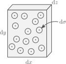
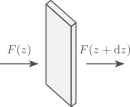
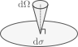
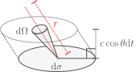

# Radiative energy transport

Goals:

- What is opacity?
- Planck's law and energy density
- Basics of diffusion
- Radiative temperature gradient

## What is opacity?

One form in which energy is transported in stellar interiors is through radiation. However, most of the star is opaque, and photons can only travel short distances before being scattered or absorbed. The "opaqueness" of stellar matter can be described by the opacity $\kappa$, which has units of

$$[\kappa]=\mathrm{cm^{2}\,g^{-1}},$$

where brackets denote the units of what is inside.

So what is opacity? Let's start by thinking of a medium with particles of mass $m$, which interact with passing radiation. We will consider each particle acts as a disk of area $\sigma$ (its cross section), and that all radiation is absorbed when it hits a particle. We can now consider a thin slab of material as follows:

The total number of particles in the slab is

$$dN = \frac{\rho}{m}\mathrm{d}x\mathrm{d}y\mathrm{d}z,$$

which means that the probability of a photon going through the slab and crashing with a particle is

$$P_\mathrm{coll}=\frac{\sigma \mathrm{d}N}{\mathrm{d}x\mathrm{d}y}=\frac{\sigma \rho}{m}\mathrm{d}z.$$

From here we have the term

$$\left[\frac{\sigma}{m}\right]=\mathrm{cm^2\,g^{-1}},$$

which has the units of opacity. Indeed, opacity can be described as a cross section per unit mass, and for this specific example we take

$$\kappa\equiv \frac{\sigma}{m}\rightarrow P_\mathrm{coll}=\kappa\rho\mathrm{d}z.$$

Now let's see how flux changes as it goes through the slab:

 

Absent any emission from the slab itself, the difference between the fluxes at the faces is just

$$F(z)-F(z+\mathrm{d}z)=F(z)P_\mathrm{coll}=F(z)\kappa\rho\mathrm{d}z,$$

and approximating the difference in flux with a partial derivative gives us a differential equation for the flux,

$$\frac{\mathrm{d}F}{\mathrm{d}z} = -\kappa\rho F(z).$$

For a constant $\kappa\rho$, the solution to this differential equation corresponds to exponential decay,

$$F(z)=F(z_0)e^{-\kappa\rho(z-z_0),}$$

where $z_0$ is a reference point. From here we have two important concepts:

- The factor $\kappa\rho$ in the exponential has units
   
   $$[\kappa\rho]=\mathrm{cm}^{-1},$$

   so we can define a mean free path for photons as

   $$\displaystyle l_\mathrm{f}=\frac{1}{\kappa\rho}$$

   This corresponds to the typical distance travelled by a photon before colliding. Note however that opacity is actually frequency dependent (denoted by $\kappa_\nu$), so light of different frequencies will have different mean free paths.
   
-  If we also consider radiation travelling a distance $d$ through a medium, we can define a dimensionless optical depth $\tau$ as
   
   $$\tau = \frac{d}{l_\mathrm{f}}=\kappa\rho d.$$

   The optical depth then represents the number of mean free paths covered by $d$. In practice $\kappa\rho$ varies through a medium, so instead one uses

   $$d\tau = \kappa\rho \mathrm{d}z.$$

   For a star, the optical depth normally refers to the value integrated from an infinite distance all the way to its surface,

   $$\tau(r) = \int_r^\infty \kappa\rho \mathrm{d}r,$$

   and as we will see later, a usual definition of a stars surface, its photosphere, is taken to be at $\tau=2/3$.

## Planck's law

Let's consider radiation is in local thermodynamical equilibrium with the gas at a temperature $T$. Then its energy flux per unit frequency and solid angle is:

$$B_\nu (\nu,T)=\frac{2h\nu^3}{c^2}\frac{1}{\displaystyle \exp\left(\frac{h\nu}{k_\mathrm{B}T}\right)-1}.$$

What does this imply for the distribution of momenta? Remember that we defined the distribution $f(p)$ in terms of the number of particles per unit volume and unit momentum.

We take an area element $\mathrm{d}A$, and photons crossing it with a momentum covering a solid angle $\mathrm{d}\Omega$ around the perpendicular direction,

In a time $\mathrm{d}t$, the number of photons crossing $\mathrm{d}A$ with directions contained in $\mathrm{d}\Omega$ is

$$\mathrm{d}N=f(p)c\mathrm{d}t\mathrm{d}A\frac{\mathrm{d}\Omega}{4\pi}\mathrm{d}p,\tag{4.1}$$

where we used the velocity of the photons being the speed of light $c$ and took an isotropic $f(p)$. Each individual photon carries an energy $h\nu$, so the energy corresponding to $\mathrm{d}N$ is

$$\mathrm{d}E=h\nu \mathrm{d}N.\tag{4.2}$$

Similarly, the momentum of each photon is

$$p=\frac{h\nu}{c}\rightarrow \mathrm{d}p=\frac{h}{c}\mathrm{d}\nu.\tag{4.3}$$

Combining equations $(4.1)$, $(4.2)$ and $(4.3)$ we find that

$$\frac{\mathrm{d}E}{h\nu}=f(p)c\mathrm{d}t\mathrm{d}A\frac{\mathrm{d}\Omega}{4\pi}\frac{h\mathrm{d}\nu}{c}$$
$$\rightarrow \frac{\mathrm{d}E}{\mathrm{d}t\mathrm{d}A\mathrm{d}\Omega\mathrm{d}\nu}=B_\nu = \frac{h^2 \nu}{4\pi}f(p).$$

We can also define the distribution per unit frequency,

$$f(p)\mathrm{d}p=f(\nu)\mathrm{d}\nu \rightarrow \boxed{f(\nu)=\frac{4\pi}{hc\nu}B_\nu.}\tag{4.4}$$

We can use the same expressions as last class to describe the contribution of radiation to energy density. Expressing the energy density per unit frequency and unit volume we have

$$U_\nu = f(\nu)h\nu = \frac{4\pi}{c}B_\nu.\tag{4.5}$$

Similarly, we can describe the flux crossing in one direction of a surface (see the following section for a derivation),

$$F=\int_0^{2\pi}\int_0^{\pi/2}\int_0^\infty \cos\theta\sin\theta B_\nu \mathrm{d}\nu \mathrm{d}\theta \mathrm{d}\phi,\tag{4.6}$$

which has an analytical solution,

$$F=\sigma T^4,\quad \sigma=\frac{2\pi^5 k_B^4}{15h^3c^2}.$$

The constant $\sigma$ is known as the Stefan-Boltzmann constant. Pressure can be found to be equal to

$$P_\mathrm{rad}=\frac{a}{3}T^4,\quad a=\frac{4\sigma}{c},$$

where $a$ is known as the radiation constant. Finally, the total energy density (per unit volume) is

$$U=aT^4. \tag{4.7}$$

## Basics of diffusion

In practice, if we want to know how much energy is being transported by radiation, we should perform the flux integral (Equation $4.6$) over the entire sphere to obtain the flux perpendicular to the surface. However, integrating the polar angle $\theta$ from zero to $\pi$ results in zero flux, as the integrand is an odd function around $\pi/2$ and contributions from below and above cancel out. This is to be expected, since if there are no asymmetries in the radiation field there is also no preferred direction towards which there would be a net energy flux.

To account for this we will do a similar integration than the one we did for the pressure integral, were we consider a certain area element $\mathrm{d}\sigma$ and ask how much energy crosses it in an amount of time $\mathrm{d} t$ coming from an orientation $\mathrm{d}\vec{\Omega}$. Since radiation travels at the speed of light, this amounts to computing the energy contained in the radiation field of the following volume (ignore the red line for now):

If we consider the corresponding energy density to be isotropically distributed, with an energy density $U_\nu$ per unit frequency, then in the direction $\mathrm{d}\vec{\Omega}$ we will have an energy density per unit solid angle and unit frequency of

$$\mathrm{d}U_\nu = \frac{U_\nu}{4\pi}\mathrm{d}\Omega = \frac{U_\nu}{4\pi} \sin\theta \mathrm{d}\theta \mathrm{d}\phi,$$

and the flux per unit frequency can be obtained by integrating over all directions to compute the flux normal to $\mathrm{d \sigma}$, which we take to be that in the $z$ direction:

$$F_{z,\nu} = - \frac{1}{\mathrm{d}t\mathrm{d}\sigma}\int_0^{2\pi}\int_0^\pi \mathrm{d}\sigma c \cos\theta \mathrm{d}t \times \frac{U_\nu}{4\pi}\sin\theta \mathrm{d}\theta \mathrm{d}\phi.\tag{4.8}$$

Other than the sign (which indicates radiation from above contributes negatively to the flux) and the range of the integral in $\theta$, this is effectively the way in which Equation $(4.6)$ is derived. And as we already argued, unless $U_\nu$ is anisotropic, the result will be no flux. So going back to the figure above, we now want to consider the impact of radiation coming unperturbed from a significant distance $r$ in the direction of $\mathrm{d}\vec{\Omega}$, where the energy density will differ. The energy density coming from $\mathrm{d}\vec{\Omega}$ can then be taken as an average along that direction,

$$dU_\nu=\left[\int_0^{\infty} \frac{U_\nu(r)}{4\pi}P(r)\mathrm{d}r\right]\text{d}\Omega,\tag{4.9}$$

where $P(r)$ describes the probability that a photon travelled unperturbed from a distance $r$ in the direction $\mathrm{d}\vec{\Omega}$. Based on our discussion of opacity at the beginning of this class, if the opacity of the material to radiation with a frequency $\nu$ is $\kappa_\nu$, we expect this to be proportional to $\exp(-\kappa_\nu \rho r)$,

$$P(r)\propto \exp(-\kappa_\nu\rho r)\rightarrow P(r)=\frac{\exp(-\kappa_\nu\rho r)}{\int_0^\infty \exp(-\kappa_\nu\rho r)\mathrm{d}r}=\kappa \rho \exp(-\kappa_\nu\rho r).$$

Here we are assuming that the the lengthscales in which the fluid changes are much larger than $l_f=(\kappa_\nu \rho)^{-1}$, such that variations of $\kappa_\nu$ and $\rho$ with respect to $r$ are ignored. Similarly, we can also approximate $U_\nu(r)$ based on its value at $r=0$ and its gradient:

$$U_\nu(r) = U_{\nu,r=0} + (\nabla U_\nu)_{r=0}\cdot \vec{r}= U_\nu + (\nabla U_\nu \cdot \hat r) r,$$

where $\hat{r}$ is the unit vector in that direction and we drop the subscript $r=0$ for simplicity in the last step. Using this result for $U_\nu(r)$ in Equation $(4.9)$ we obtain:

$$dU_\nu =\left[\frac{U_\nu}{4\pi} + \frac{\nabla U_\nu \cdot \hat{r}}{4\pi\kappa\rho}\right]\text{d}\Omega.$$

We can now use this instead of just $(U_\nu/4\pi)\mathrm{d}\Omega$ to determine the flux in the $z$ direction in Equation $(4.8)$. Doing so and simplifying gives us

$$F_{z,\nu} = - \frac{c}{4\pi}\int_0^{2\pi}\int_0^\pi \left[U_\nu + \frac{\nabla U_\nu \cdot \hat{r}}{\kappa\rho}\right]\cos\theta \sin\theta \mathrm{d}\theta \mathrm{d}\phi.\tag{4.10}$$

To compute this integral, we can immediately ignore the first term in the brackets as it integrates over the isotropic $U_\nu$ resulting in zero. For the gradient term, we can write

$$\nabla U_\nu\cdot \hat{r} = \sin\theta\cos\phi \frac{\partial U_\nu}{\partial x} + \sin\theta\sin\phi \frac{\partial U_\nu}{\partial y}+\cos\theta\frac{\partial U_\nu}{\partial z},$$

where $x$ and $y$ represent cartesian coordinates along $d\sigma$. One can now see that integration over $\theta$ in Equation $(4.10)$ will only leave the term with the $z$ derivative, as the other two result in odd functions with respect to $\theta=\pi/2$, leaving for the flux the integral:

$$F_{z,\nu} = -\frac{c}{4\pi\kappa \rho}\frac{\partial U_\nu}{\partial z}\int_0^{2\pi}\int_0^\pi \cos^2\theta\sin\theta \mathrm{d}\theta\mathrm{d}\phi=-\frac{1}{3}\frac{c}{\kappa\rho}\frac{\partial U_\nu}{\partial z}.$$

Generalization to three dimensions is then simply:

$$\vec{F}_\nu=-D_\nu\nabla U_\nu,\quad D_\nu \equiv \frac{1}{3}\frac{c}{\kappa_\nu \rho}.\tag{4.11}$$

This is a standard form for a diffusion equation, where a flux is determined by the gradient of a density and a diffusion coefficient. The difussion coefficient takes the form $v l_\text{f}/3$, where v is the velocity of the particles diffusing and $l_\text{f}$ their mean free path, which in the case of radiation are the speed of light and $l_\text{f}=(\kappa\rho)^{-1}$. We will later discuss diffusion of elements that can mix regions with different compositions, in which case we need to consider particles of different velocities and a corresponding average $\langle v l_\text{f}\rangle$.

Equation $(4.11)$ provides us with a mechanism to compute the local flux per unit frequency if we know the opacity, density and energy density gradient. In the oversimplified case where we have a single frequency independent opacity $\kappa$, Equation $(4.11)$ can be integrated over frequency giving the total flux:

$$\vec{F} = -\frac{c}{3\kappa \rho}\nabla U.\tag{4.12}$$

## Radiative temperature gradient

Given the equation for the flux $(4.11)$, and since the energy density of radiation $U_\nu$ is a function of frequency and temperature, we can express the flux as a function of temperature,

$$\vec{F}_\nu = -\frac{c}{3\kappa\rho}\frac{\partial U_\nu}{\partial T}\nabla T,$$

The partial derivative $\partial U_\nu/\partial T$ is positive, which indicates radiative energy flux proceeds from regions of higher to lower temperature. For simplicity, let us consider the case where opacity is independent of frequency, given by Equation $(4.12)$. Combining this with the energy density given by Equation $(4.7)$ we obtain

$$\vec{F} = -\frac{4acT^3}{3\kappa\rho}\nabla T.\tag{4.13}$$

Assuming radial symmetry, this allows us to express a relationship between luminosity and the temperature gradient.

$$F_r = \left. -\frac{4acT^3}{3\kappa\rho}\frac{\partial T}{\partial r}\quad\right/\times 4\pi r^2\cdot $$
$$L = -\frac{16 \pi r^2 acT^3}{3\kappa\rho}\frac{\partial T}{\partial r}$$
$$\rightarrow \boxed{\frac{\partial T}{\partial r}=-\frac{3\kappa \rho L}{16\pi r^2 a c T^3}}.\tag{4.14}$$

Whenever energy transport happens through radiation, this equation describes the temperature gradient required. In cases where other mechanisms also transport energy and contribute to $L$, equation (4.14) describes the radiative luminosity $L_\mathrm{rad}$ rather than the total one.

One generally transforms equation (4.14) into a pressure derivative by using the equation of hydrostatic equilibrium,

$$\frac{\partial P}{\partial r} = -\rho\frac{Gm}{r^2},$$

from which we get

$$\left.\frac{\partial T}{\partial P}=\frac{\partial T}{\partial r}\left(-\frac{r^2}{\rho G m}\right) = \frac{3\kappa L}{16\pi ac G T^3 m}\quad\right/ \frac{P}{T}\cdot$$
$$\boxed{\nabla_\mathrm{rad}\equiv\frac{\partial \ln T}{\partial \ln P}=\frac{3}{16\pi a c G}\frac{\kappa L P}{m T^4}}\tag{4.15}.$$

The quantity $\nabla_\mathrm{rad}$ will be particularly important in our discussion of convection in the next class.

In reality any practical application needs to consider that opacity is a function of frequency. In that case we use instead $(4.11)$ combined with $(4.5)$ to describe the flux per unit frequency in terms of the Planck function,

$$\vec{F}_\nu=-\frac{4\pi}{3\kappa_\nu \rho}\frac{\partial B_\nu}{\partial T}\nabla T$$

This can be rearranged into a form that resembles (4.13),

$$\vec{F}_\nu = -\frac{4acT^3}{3\rho}\left[\frac{3\rho}{4ac T^3}\times \frac{4\pi}{3\kappa_\nu \rho}\frac{\partial B_\nu}{\partial T} \right]\nabla T$$
$$=-\frac{4acT^3}{3\rho}\left[\frac{\pi}{ac T^3\kappa_\nu}\frac{\partial B_\nu}{\partial T} \right]\nabla T$$

The purpose of doing this is that we can integrate over frequency to get the total flux, and obtain an expression similar to $(4.13)$ but with a redefined opacity,

$$\vec{F} = -\frac{4acT^3}{3\kappa_\text{R}\rho}\nabla T$$

where $\kappa_\mathrm{R}$ is the Rosseland mean opacity

$$\frac{1}{\kappa_\mathrm{R}}\equiv \frac{\pi}{acT^3}\int_0^\infty\frac{1}{\kappa_\nu}\frac{\partial B_\nu}{\partial T}\mathrm{d}\nu.$$

So we can treat radiation as if it had a single frequency independent opacity, which is constructed as a sort-of average of $\kappa_\nu$ with the Planck function. This allows us to write the general expression for the radiative temperature gradient:

$$\nabla_\mathrm{rad}=\frac{3}{16\pi a c G}\frac{\kappa_\mathrm{R} L P}{m T^4},$$

## Conduction

We can also consider conduction in Equation $(4.15)$. The flux can be taken to be proportional to the temperature gradient, with
two contributions given by conduction coefficients for radiative
energy transport and one for actual particle conduction:

$$\vec{F}=(k_\mathrm{rad}+k_\mathrm{cd})\nabla T,$$

where

$$k_\mathrm{rad}=\frac{4ac}{3}\frac{T^3}{\kappa_\mathrm{rad}\rho}.$$

The conduction coefficient $k_\mathrm{cd}$ is determined by the energy density of the particles, their velocity $v$, mean free path $l$, and their internal energy density,

$$k_\mathrm{cd}=D_\text{cd}\frac{\partial U}{\partial T},\; D_\text{cd}=\frac{lv}{3}.$$

It is common to define a conductive opacity $\kappa_\mathrm{cd}$ as

$$k_\mathrm{cd}=\frac{4ac}{3}\frac{T^3}{\kappa_\mathrm{cd}\rho},$$

From which we can use the same expression for the temperature gradient $(4.13)$ but with the opacity replaced with

$$\frac{1}{\kappa}=\frac{1}{\kappa_\mathrm{R}}+\frac{1}{\kappa_\mathrm{cd}},$$

In this sense the lowest opacity, indicating more transparency, dominates.