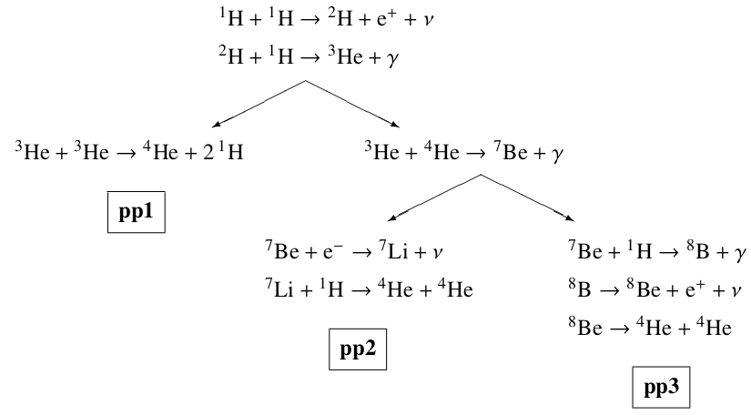

# Exercises

## List of exercises

### 1: The nuclear timescale

The objective of this exercise is to determine the nuclear burning timescale $\tau_{\mathrm{nuc}}$ for stars of different masses. For simplicity, let us take the entire star to be composed of hydrogen, and assume a fraction $\alpha$ of it is burnt into helium. For a luminosity $L$, which we take to be constant through the main sequence, and an energy $\epsilon$ released per gram of hydrogen fused, the nuclear timescale is

$$\tau_{\mathrm{nuc}}=\frac{\alpha M\epsilon}{L}.$$
 
- First compute the energy release $\epsilon$ for hydrogen fusion taking into account the atomic masses of hydrogen and helium.

  | **element** | $Z$ | $A$ | $m/m_u$ |
  |:-----------:|:---:|:---:|:----------:|
  |    **H**    |  1  |  1  |  1.007825  |
  |    **He**   |  2  |  4  |  4.002603  |

  Remember that the atomic mass unit $m_u$ (defined as $1/12$ times the mass of the $^{12}\mathrm{C}$ atom) is equal to $1.660540\times 10^{-24}\,\mathrm{g}$. Also, the speed of light is equal to $c\simeq 3\times 10^{10}$. With this information compute the value of $\epsilon$ while ignoring energy losses due to neutrinos. Remember that atomic masses refer to neutral atoms, so they include electron masses.

- In the next class we will show that stars follow a steep mass luminosity relationship: 

  $$L\propto M^{3}\:,$$ 

  the exponent is modified from $3$ in connection with the exact form of the surface opacity and nuclear burning process powering the star. It is also modified at very high masses as they approach the Eddington limit. But an exponent of $3$ is a good approximation through a broad range of masses. Using this power law dependence, determine $\tau_\mathrm{nuc}$ for stars of masses $1M_\odot$, $10M_\odot$ and $100M_\odot$. For reference, the solar luminosity is $L_\odot\sim 3.9\times 10^{33}\,\mathrm{erg}\,\mathrm{s}^{-1}$ and the solar mass is $M_\odot\sim 2.0\times 10^{33}\,\mathrm{g}$. Take $\alpha=0.1$.

- From detailed calculations, it's shown that for very high mass stars $\gtrsim 100\:M_{\odot}$ the ZAMS mass-luminosity relation becomes almost linear. What does this imply for the scaling of $\tau_\mathrm{nuc}$ with mass?

### 2: Energetics of the pp-chains

Let's study the $Q$-value of the three pp-chains. Remember that the definition of the $Q$-value for a nuclear reaction is

$$Q\equiv (m_X+m_a-m_Y-m_b)c^2\hspace{0.75cm}\mathrm{with}\hspace{0.25cm}X+a\rightarrow Y+b\:,$$

where we are schematizing a reaction of the nucleus $X$, of mass $m_Y$, with a particle $a$, of mass $m_a$ which produces a nucleus $Y$ and a particle $b$, with masses $m_Y$ and $m_b$ respectively. Recalling the scheme of the three pp-chains

you can see that three of the reactions in the chains are accompanied by neutrino emission. The average neutrino energy $\left<E_{\nu}\right>$ is different in each chain (see section 18.1 of [Stellar Structure and evolution](https://link.springer.com/book/10.1007/978-3-642-30304-3) by Kippenhahn, Weigert & Weiss):

$^1\mathrm{H}+^1\mathrm{H}\rightarrow ^2\mathrm{H}+e^++\nu\hspace{1cm}$ gives $\left<E_{\nu}\right>=0.267\:\mathrm{MeV}$

$^7\mathrm{Be}+e^-\rightarrow ^7\mathrm{Li}+\nu\hspace{1cm}$ gives $\left<E_{\nu}\right>=0.738\:\mathrm{MeV}$

$^8\mathrm{B}\rightarrow ^8\mathrm{Be}+e^++\nu\hspace{1cm}$ gives $\left<E_{\nu}\right>=6.735\:\mathrm{MeV}$

Considering these energy losses calculate the total effective $Q$-value for the production of one $^4\mathrm{He}$ nucleus in each chain.

### 3: Distribution of relative velocities

Show that the distribution of relative velocities between particles in a gas, where the individual particle velocities follow a Maxwellian distribution, also follows a Maxwellian distribution. Remember that a Maxwellian distribution for the velocity arises from each of the components of the velocity $(v_x,v_y,v_z)$ satisfying a Gaussian distribution centered at zero.

## Solutions

### 1: The nuclear timescale

- We start by computing the total energy released from fusing four hydrogen atoms into a helium atom,

  $$Q=(4m_\mathrm{H}-m_\mathrm{He})c^2$$

  where $m_\mathrm{H}$ and $m_\mathrm{He}$ are the masses of the hydrogen and helium atoms (their atomic masses multiplied by the atomic mass unit). This results in

  $$Q= 4.3\times 10^{-5}\,\mathrm{erg}=26.8\,\mathrm{MeV}.$$

  Part of this energy is lost to neutrino emission, but we are ignoring that for the moment. We want the energy released per unit mass, which is

  $$\epsilon = \frac{Q}{4 m_\mathrm{H}}=6.4\times 10^{18}\,\mathrm{erg}\,\mathrm{g}^{-1}.$$

- Using the solar luminosity and mass as a scaling factors, the given mass luminosity relationship implies

  $$\displaystyle L = L_\odot \left(\frac{M}{M_\odot}\right)^3$$

  which in turn gives for the nuclear timescale

  $$\tau_\mathrm{nuc}=\frac{\alpha M\epsilon}{L_\odot}\left(\frac{M}{M_\odot}\right)^{-3}$$
  $$= \frac{\alpha M_\odot \epsilon}{L_\odot}\left(\frac{M}{M_\odot}\right)^{-2}$$

  We can evaluate the factor outside parenthesis (using $\alpha=0.1$) to obtain

  $$\tau_\mathrm{nuc}\simeq 10\,[\mathrm{Gyr}]\left(\frac{M}{M_\odot}\right)^{-2}.$$

  With this we quickly estimate that the (hydrogen) nuclear burning lifetimes of stars of masses $1M_\odot$, $10M_\odot$ and $100M_\odot$ would be $10\,\mathrm{Gyr}$, $100\,\mathrm{Myr}$ and $1\,\mathrm{Myr}$. The lifetime of stars changes dramatically with mass! Although the power-law index in the mass luminosity relationship changes significantly with mass, all these estimates are correct within an order of magnitude.

- If we take into account the caveat that $L_{\mathrm{ZAMS}}\propto M_{\mathrm{ZAMS}}$ for very high masses $\gtrsim 100\:M_{\odot}$, then we obtain that the nuclear timescale becomes basically independent on the mass of the stars. This flattening of the mass luminosity relationship starts well below $100M_\odot$, so the previous part of the exercise actually underestimates the lifetime of very massive stars. Through detailed calculations, one finds that this mass-independent lifetime is about $2\;\mathrm{Myrs}$, which represents the shortest (hydrogen-burning) life any unperturbed star can have.

### 2: Energetics of the pp-chains

One could complete this exercise by computing the energy release of each individual reaction in the corresponding chain, and then add them up while substracting neutrino losses. However, it is enough to compute the total energy released by fusing four hydrogen atoms into one helium atom first. This was done in the first exercise, resulting in $Q=26.8\,\mathrm{Mev}$. The effective energy released for each of the chains can then be computed by substracting the neutrino energy losses relevant to each chain:

$$Q_\mathrm{PP-I}=Q-0.267\,\mathrm{Mev}=26.5\,\mathrm{Mev},$$
$$Q_\mathrm{PP-II}=Q-0.267\,\mathrm{Mev}-0.738\,\mathrm{Mev}=25.8\,\mathrm{Mev},$$
$$Q_\mathrm{PP-III}=Q-0.267\,\mathrm{Mev}-6.735\,\mathrm{Mev}=19.8\,\mathrm{Mev}.$$

The exact energy released by fusing hydrogen is then dependant on the ratio that each of these chains contribute.

### 3: Distribution of relative velocities

TBD