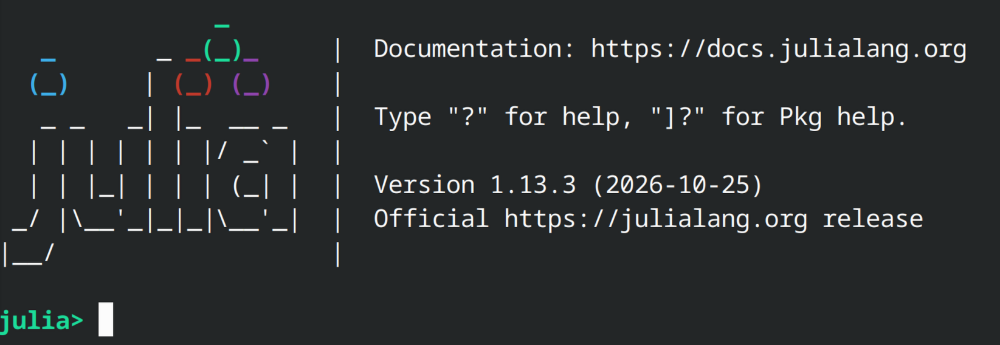

# Julia setup

Assignments in this class are meant to be completed using the julia programming language. Julia is a JIT (just-in-time) language which allows to write very fast code (very close to the performance of compiled languages like C and Fortran), while still having the simplicity of an interpreted language like python. Although the first assignment can be completed without julia, the second assignment will rely on the use of packages to run stellar evolution calculations that are exclusive to julia.

# Installation instructions

Instructions to install julia for specific platforms is provided in the [downloads](https://julialang.org/downloads/) section of the julia website. After installation, it is recommended to use individual environments for separate projects. When running julia from the terminal or shell, one can initialize julia using the present directory as the environment using `julia --project=.`. The linux bash example below creates a directory and then starts up julia using it as an environment:

```bash
mkdir lab1
cd lab1
julia --project=.
```

This should open the julia REPL (read-eval-print-loop) which allows you to run julia code directly on your terminal. This should look like this:



Using the repl is not very convenient for long sessions, one alternative that is easy to setup is to use notebooks that can be edited directly from your browser.